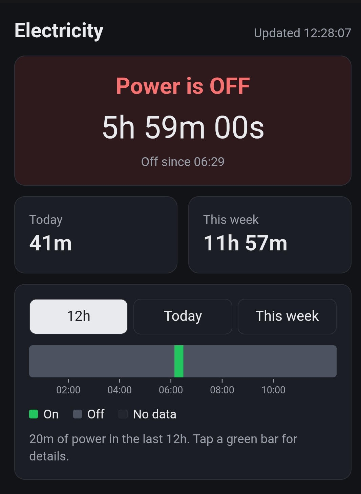

# Electricity Monitor

Know whether there's light (power) at home, since when, and how many hours you've had light today, from your phone. 

An ESP32-C3 plugged into a wall socket (preferably one powered only by NEPA) sends a heartbeat ("beat") to a Rust server every 30 seconds. When the beats stop for 90 seconds, the power is assumed to be off, i.e., there is no light. A dashboard shows the current state, today's and this week's total and a timeline. 

<!-- Full write-up: [Building a Home Electricity Monitor](add_link_to_article) -->



## Running the server

Requires Rust 1.94+ (the minimum for sqlx 0.9).

```bash
cd web
cp .env.example .env    # then set API_KEY and other variables
SQLX_OFFLINE=true cargo run --release
```

The database and tables are created on first start. Open http://localhost:3000 for the dashboard.

### Environment Variables

| Variable | Default | Meaning |
|---|---|---|
| `API_KEY` | (required) | Shared secret the device sends as a Bearer token |
| `DATABASE_URL` | `sqlite:data.db` | SQLite file |
| `BIND_ADDRESS` | `0.0.0.0:3000` | Where the server listens |
| `OUTAGE_THRESHOLD_SECS` | `90` | How long, in seconds,  without a beat before the power is marked off  |
| `UTC_OFFSET_HOURS` | `1` | Local time offset for "today" and "this week" (Lagos = 1) |

## Flashing the ESP32 
1. Install the Arduino IDE and the ESP32 board package.
2. Copy `secrets.example.h` to `secrets.h` and fill in your Wi-Fi details, the same `API_KEY` as the server, and your server's `/beat` URL.
3. Upload `electricity_monitor.ino` to your ESP32 board.

## API
| Method | Path | Notes |
|---|---|---|
| `POST` | `/beat` | Requires `Authorization: Bearer <API_KEY>` |
| `GET` | `/status/{device_id}` | Current state and since when |
| `GET` | `/summary/{device_id}` | State plus seconds of power today and this week's totals |
| `GET` | `/period/{device_id}?filter=12h\|today\|this_week` | Power spans for the timeline |
| `GET` | `/health` | Returns `OK` |

Notes:
- SQLX_OFFLINE=true makes SQLx check queries against the committed .sqlx/ folder instead of a live database, which doesn't exist until the server's first run.
